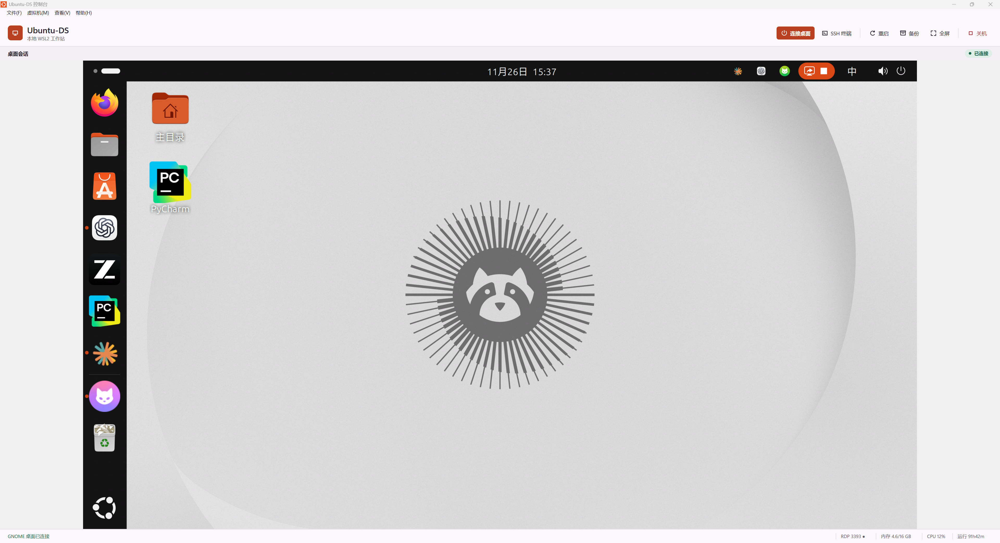

<h1 align="center">WSL-Ubuntu</h1>

在 Windows 11 的一个窗口里，打开自己的 Ubuntu GNOME 桌面。

   
  v2.1.0 · WSL 2 · Ubuntu 26.04 LTS

## 第一次打开桌面

1. **运行安装器。** 选择控制台的安装位置。首次创建 Ubuntu-DS 时可指定虚拟磁盘目录，再按需勾选附加应用。
2. **设置账号。** 首次创建的 Linux 用户密码用于安装软件。配置 GNOME 时另设一组远程桌面（RDP）凭据，下一步登录时会用到。
3. **进入 GNOME。** 双击 Windows 桌面的 **Ubuntu-DS Console**，等待控制台连接，再用 RDP 凭据登录。看到 Ubuntu 桌面后，就可以从 Dock 打开应用了。

[查看安装向导的详细步骤](docs/installation.md#使用安装向导)

## 文档导航

| 我想做什么 | 从这里开始 |
| --- | --- |
| 手动安装 | [下载 Windows ZIP](https://github.com/Jinmy414/WSL-Ubuntu/releases/download/v2.1.0/WSL-Ubuntu-2.1.0-windows.zip) · [按步骤安装](docs/installation.md#使用-zip-手动安装) |
| 用终端、备份或关机 | [控制台日常操作](docs/usage.md) |
| 桌面连不上，或 Ubuntu 应用无法联网 | [连接和网络排查](docs/troubleshooting.md) |
| 了解桌面如何连接到 Windows | [GNOME 会话与 RDP 中继](docs/architecture.md) |
| 更新已有安装 | [升级与回退](docs/installation.md#升级与回退) · [更新记录](CHANGELOG.md) |

[发布文件与 SHA-256](https://github.com/Jinmy414/WSL-Ubuntu/releases/tag/v2.1.0) · [问题反馈](https://github.com/Jinmy414/WSL-Ubuntu/issues) · [联系维护者](mailto:1792267909@qq.com)

Windows 安装器和 ZIP 可免费下载使用。[使用许可](LICENSE) · [v1.0.1 源码版](https://github.com/Jinmy414/WSL-Ubuntu/tree/v1.0.1) · [历史 MIT 许可](LEGACY-MIT.txt)
