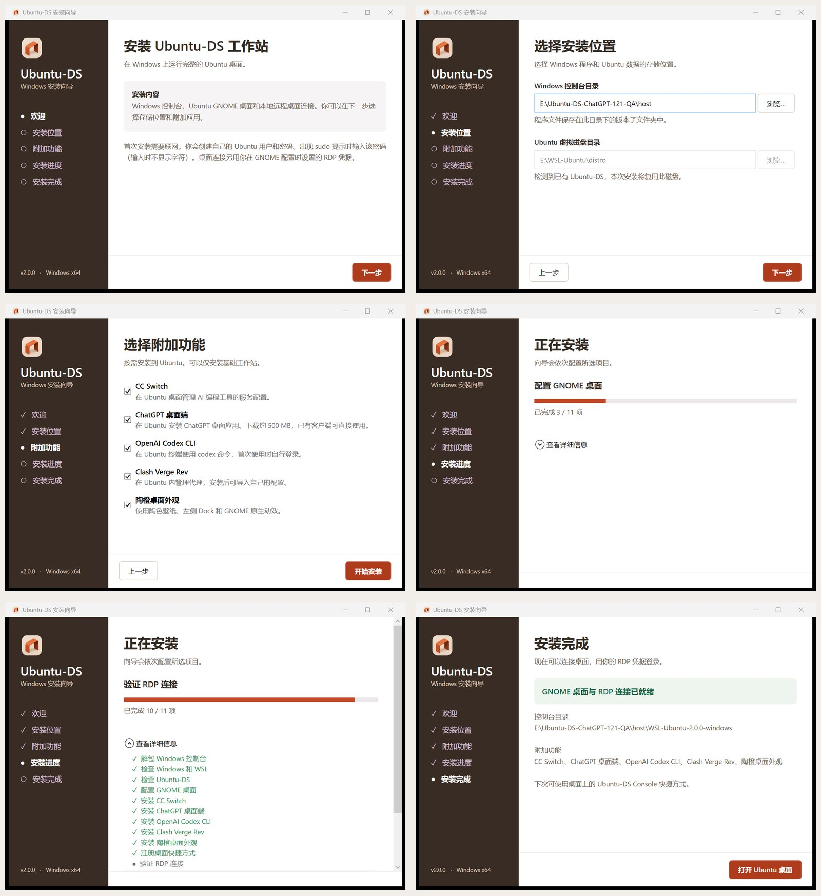

# WSL-Ubuntu

在 Windows 11 的一个窗口里使用完整的 Ubuntu GNOME 桌面。打开 Ubuntu-DS 控制台即可启动 WSL 2 会话，连接后可以直接操作 Linux 应用，在窗口底部查看内存、CPU 和运行时间。

[下载 Windows 安装器 · v2.0.0](https://github.com/Jinmy414/WSL-Ubuntu/releases/download/v2.0.0/WSL-Ubuntu-2.0.0-Setup.exe) · [下载 ZIP](https://github.com/Jinmy414/WSL-Ubuntu/releases/download/v2.0.0/WSL-Ubuntu-2.0.0-windows.zip) · [安装指南](docs/installation.md) · [连接排查](docs/troubleshooting.md) · [工作原理](docs/architecture.md)

*本机定制工作站实拍。桌面应用和壁纸由用户配置，公开版工具栏中的终端入口标为「终端」。*

## 使用安装器

运行 **WSL-Ubuntu-2.0.0-Setup.exe**，按向导选择安装位置和附加功能。

查看安装向导实拍（五个页面和展开后的进度详情）

1. **安装位置**　选择 Windows 控制台目录。首次创建 Ubuntu-DS 时，还可以指定一个空目录存放虚拟磁盘。已注册的 Ubuntu-DS 会显示当前磁盘位置并直接复用。
2. **附加功能**　CC Switch、ChatGPT 桌面端、OpenAI Codex CLI 和 Clash Verge Rev 可分别勾选。ChatGPT 在 Ubuntu 中以独立窗口运行，首次下载约 500 MB；已有桌面客户端会复用。勾选「陶橙桌面外观」可应用壁纸、左侧 Dock 和系统动效。
3. **安装进度**　进度条显示已完成的步骤，展开「查看详细信息」可查看检查清单与错误信息。遇到 Windows 重启提示时，重新登录后再次打开安装器。
4. **打开桌面**　使用自己在 GNOME 配置时设置的 RDP 凭据登录。以后可通过桌面上的 **Ubuntu-DS Console** 快捷方式连接。

首次创建 Linux 用户时请自行设置密码。安装软件出现 `sudo` 提示时输入这个 Linux 用户的密码，终端输入时不显示字符。安装包、SHA-256 和版本说明见 [v2.0.0 发布页](https://github.com/Jinmy414/WSL-Ubuntu/releases/tag/v2.0.0)。

## 使用 ZIP 手动安装

1. 下载并解压 Windows ZIP，在包含 `bin` 和 `setup` 的目录中打开 PowerShell，按[安装指南](docs/installation.md)准备专用的 Ubuntu 26.04 LTS 发行版，完成预检并安装。ZIP 已包含编译好的 Windows 控制台。
2. 配置本机 RDP 登录凭据后，打开桌面上的 **Ubuntu-DS Console**。控制台会等待 GNOME 和 RDP 中继就绪，再连接桌面。
3. 首次连接使用上一步创建的凭据登录。遇到连接问题，从「帮助 → 运行连接诊断」查看网络、GNOME 服务和 RDP 握手分别进行到了哪一步。

## 日常操作

| 操作 | 入口 |
| --- | --- |
| 开机并连接 | 桌面快捷方式 **Ubuntu-DS Console** |
| 独立远程桌面 | `bin\ds-desktop.cmd` |
| 打开终端 | 控制台工具栏或 `bin\ds.cmd` |
| 使用当前代理执行命令 | `bin\ds.cmd <命令>` 或 `bin\ds-root.cmd <命令>` |
| 诊断连接 | 控制台「帮助 → 运行连接诊断」或 `bin\ds-doctor.cmd` |
| 备份或关机 | 控制台「虚拟机」菜单里的「备份」或「关机」 |

## 下载与许可

需要查看或修改源码时，请使用 [v1.0.1 源码版](https://github.com/Jinmy414/WSL-Ubuntu/tree/v1.0.1)。这是官方保留的唯一源码发行版。新版控制台和安装向导在私有仓库构建，用户可免费下载 Windows 安装器或 ZIP。此前已按 MIT 发布的代码继续适用[原有许可](LEGACY-MIT.txt)，新版新增专有部分的授权见[使用许可](LICENSE)。

安装引导和文档组织参考了 [Fedora Remix for WSL](https://github.com/WhitewaterFoundry/Fedora-Remix-for-WSL)。使用中遇到问题，可查看[连接排查](docs/troubleshooting.md)或在[公开仓库反馈](https://github.com/Jinmy414/WSL-Ubuntu/issues)。历史版本的变更见[更新记录](CHANGELOG.md)。

## 联系

邮箱 <1792267909@qq.com>
