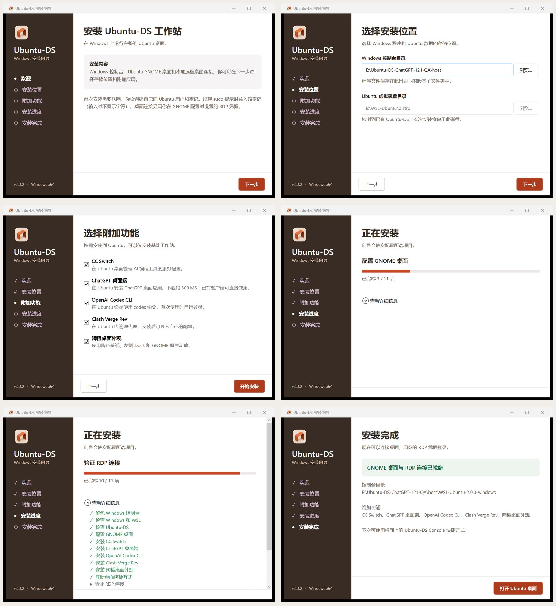

# 安装 WSL-Ubuntu

在 Windows 11 上使用 WSL 2 和 Windows 远程桌面客户端（`mstsc.exe`）连接专用的 Ubuntu 26.04 LTS 发行版 `Ubuntu-DS`。第一次安装推荐使用图形向导。需要分别配置 Windows 和 Ubuntu 两端时，直接跳到 [ZIP 手动安装](#使用-zip-手动安装)。

## 使用安装向导

1. 从 [v2.1.0 发布页](https://github.com/Jinmy414/WSL-Ubuntu/releases/tag/v2.1.0) 下载并运行 **WSL-Ubuntu-2.1.0-Setup.exe**。
2. 在「安装位置」选择 Windows 控制台目录。新建 Ubuntu-DS 时，为虚拟磁盘选择空目录。若向导显示已有 Ubuntu-DS 的磁盘位置，它将复用该发行版。
3. 在「附加功能」勾选需要的应用，也可以全部取消。CC Switch、Clash Verge Rev、ChatGPT 桌面端和 OpenAI Codex CLI 安装在 Ubuntu 中。可勾选「陶橙桌面外观」应用壁纸、Dock 和系统动效。Codex CLI 首次使用时需要登录。
4. 开始安装，按提示完成 Ubuntu 配置。创建普通用户时设置 Linux 密码，遇到 `sudo` 提示就输入这个密码，输入时终端不会显示字符。配置 GNOME 远程桌面时，记下单独设置的 RDP 用户名和密码。
5. 进度停住时，展开「查看详细信息」查看当前步骤。若提示重启 Windows，重启并登录后再次打开安装器。安装完成后转到[首次连接](#首次连接)。

<details><summary>查看安装向导实拍</summary>



</details>

## 使用 ZIP 手动安装

从 [v2.1.0 发布页](https://github.com/Jinmy414/WSL-Ubuntu/releases/tag/v2.1.0) 下载 **WSL-Ubuntu-2.1.0-windows.zip** 和对应的 `.sha256` 文件。在下载目录打开 PowerShell，运行以下命令，将结果与校验文件第一列核对。

```powershell
Get-FileHash .\WSL-Ubuntu-2.1.0-windows.zip -Algorithm SHA256
```

将 ZIP 解压到 Windows 本地磁盘的固定目录。接下来的命令都从包含 `bin` 和 `setup` 的解压目录运行。

### 准备 Ubuntu-DS

先运行 `wsl.exe --list --verbose`。如果已有专用的 Ubuntu 26.04 LTS 发行版 `Ubuntu-DS` 且 VERSION 为 2，可直接进入[安装前检查](#安装前检查)。首次创建时运行以下命令。

```powershell
wsl.exe --update
wsl.exe --install Ubuntu-26.04 --name Ubuntu-DS
wsl.exe --list --verbose
```

首次打开 Ubuntu 时，按提示创建可使用 `sudo` 的普通用户并设置 Linux 密码。WSL 安装与发行版要求见官方说明。 [Canonical 安装文档](https://ubuntu.com/wsl/docs/latest/howto/install-ubuntu-wsl2/)

需要显式配置 Windows 共享网络时，将下载包的 `setup\wslconfig.example` 中的设置合并到 Windows 用户目录的 `.wslconfig`。设置作用于该用户的全部 WSL 2 实例。保存工作并退出所有 WSL 会话后运行 `wsl.exe --shutdown`，再次启动时读取新设置。 [Microsoft WSL 配置文档](https://learn.microsoft.com/zh-cn/windows/wsl/wsl-config)

### 安装前检查

从下载包的解压目录运行以下两个命令。Windows 检查确认 WSL、桌面客户端和本地端口。Ubuntu 检查确认发行版、systemd 用户会话和 RDP 端口。

```powershell
powershell.exe -NoProfile -ExecutionPolicy Bypass -File .\setup\install-windows.ps1 -Check
wsl.exe -d Ubuntu-DS -- bash ./setup/install-guest-desktop.sh --check
```

系统提示启用 systemd 时，在 Ubuntu 的 `/etc/wsl.conf` 中合并以下设置。保存工作并退出 Ubuntu，再从 Windows 运行 `wsl.exe --terminate Ubuntu-DS`，重新执行检查。

```ini
[boot]
systemd=true
```

### 配置 GNOME 和 Windows 控制台

在同一个 PowerShell 窗口依次执行。

```powershell
wsl.exe -d Ubuntu-DS -- bash ./setup/install-guest-desktop.sh
powershell.exe -NoProfile -ExecutionPolicy Bypass -File .\setup\install-windows.ps1
```

Ubuntu 安装程序会生成本地 TLS 证书。初次设置时，请按提示创建 RDP 用户名和密码。重复安装使用已有的 RDP 凭据。若要主动重设，向 Ubuntu 安装命令传入 `--reset-rdp-credentials`。 [GNOME Remote Desktop 的单用户无头会话配置](https://github.com/GNOME/gnome-remote-desktop/blob/main/docs/configuration.md#headless-single-user)

从 v1.1.0 起，Ubuntu 安装程序默认从官方 GitHub 安装 Clash Verge Rev，并在本机验证下载包的 SHA-256。首次使用代理需要在 Clash 里导入自己的配置并选择节点。可加 `--skip-clash` 跳过安装，或者在 Ubuntu 内运行 `bash setup/install-clash.sh` 单独重试。 [Clash Verge Rev 官方发布](https://github.com/clash-verge-rev/clash-verge-rev/releases/tag/v2.5.10)

Windows 安装程序默认使用 ZIP 内的 `bin\UbuntuDS-Console.exe`，创建桌面快捷方式与按需启动的保活任务。以前使用的 `-UsePackagedConsole` 参数仍然有效。

## 首次连接

双击 Windows 桌面的 **Ubuntu-DS Console**，等待 GNOME 和 RDP 中继就绪。输入配置 GNOME 时设置的 RDP 用户名和密码。看到 GNOME 桌面后，即可打开 Ubuntu 应用。

遇到自签名证书提示时，可先查看本机证书指纹，再与远程桌面提示中的证书指纹核对。

```bash
openssl x509 -in ~/.local/share/gnome-remote-desktop/ubuntu-ds.crt -noout -fingerprint -sha1
```

如果一直停在连接界面，打开「帮助 → 运行连接诊断」，按[连接排查指南](troubleshooting.md)核对失败的步骤。

## 陶橙桌面与 ChatGPT

安装器中的「陶橙桌面外观」会保存当前用户的外观设置，然后应用壁纸、左侧 Dock 和原生动效。首次新建 Ubuntu-DS 时默认勾选。升级已有工作站时可以自行选择。手动配置时，在解压目录中运行以下命令。

```bash
bash setup/install-components.sh clay
```

如需恢复之前的外观，运行以下命令。此后手动调整过的设置会保留。

```bash
/usr/bin/python3 setup/clay-desktop.py --restore
```

「ChatGPT 桌面端」在 Ubuntu 应用菜单中显示为 **ChatGPT**，使用者自行登录。首次下载约 500 MB，已安装客户端时直接复用。安装 Codex 命令行工具请另行勾选 **OpenAI Codex CLI**。

## 升级与回退

先读目标版本的 [更新记录](../CHANGELOG.md)，确认修复的问题、配置变化和升级步骤。

- 更新 Windows 控制台时，把新版解压到独立目录，保留旧版目录和下载包。通过新版预检后，再让桌面快捷方式指向新版。回退时可直接打开旧目录中的控制台，或把快捷方式指回旧版。
- 更新 Ubuntu 里的 GNOME、RDP 或代理服务前，先保存工作并用现有控制台导出 `Ubuntu-DS` 的 VHDX 备份。Windows 控制台与 Ubuntu 服务分别安装。若升级同时改动了 Ubuntu，回退时也需要恢复对应的 Ubuntu 备份。

[控制台日常操作](usage.md) · [返回项目首页](../README.md)
